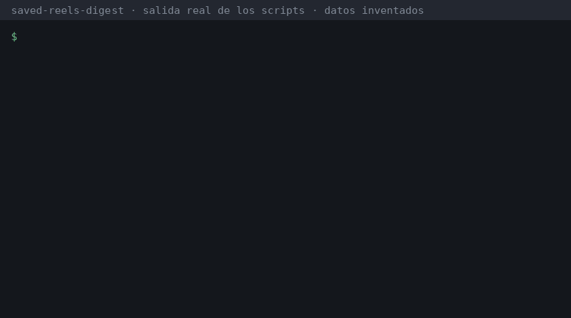

# Saved Reels Digest

[](https://github.com/ArmasCitoZ/saved-reels-digest/actions/workflows/ci.yml)
[](.claude-plugin/plugin.json)

[](LICENSE)

**Claude revisa por ti los reels que tienes guardados en Instagram.** Se queda solo con los del tema que te interesa (por defecto tech, IA y Claude), los transcribe, junta los que cuentan lo mismo y te deja un único documento ordenado por lo que más merece la pena.

> Guardas 200 reels de "este truco de Claude te cambia la vida" y nunca vuelves a verlos. Esto los convierte en una lista que sí vas a usar.



**Gratis de verdad:** no usa APIs de pago ni claves. La transcripción se hace en tu ordenador con [Whisper](https://github.com/SYSTRAN/faster-whisper) y el análisis lo hace Claude Code con tu suscripción normal. Tus datos se quedan en tu ordenador.

[English below](#english)

---

## Qué hace

1. **Recoge tus guardados.** Hay tres formas:
   - con la **exportación oficial** de Instagram, que no tiene ningún riesgo para tu cuenta;
   - con tu **sesión del navegador** (Chrome, Firefox, Edge...), que es al instante;
   - o haciendo que Claude **navegue tu página de guardados**, si tienes Claude in Chrome.

   ¿También guardas en TikTok? Tus **Favoritos** entran en el mismo resumen con la exportación oficial de TikTok (Ajustes y privacidad → Cuenta → Descargar tus datos → formato JSON).

   ¿Y **YouTube**? Tu lista *Ver más tarde* y tus listas de reproducción también entran, con [Google Takeout](https://takeout.google.com) (YouTube y YouTube Music) o leyendo una lista directamente.
2. **Lee los textos** de cada publicación y descarta lo que no es de tu tema (recetas, memes, viajes...).
3. **Transcribe en local** solo los reels que importan. El audio se borra justo después. Los **carruseles** y las fotos no tienen audio, así que Claude mira las imágenes y se queda con el texto; las imágenes también se borran.
4. **Junta los duplicados.** Si tres creadores explican el mismo truco, sale una sola entrada con lo mejor de cada uno y los tres enlaces. También marca contradicciones y cosas que suenan a hype o que pueden estar desactualizadas.
5. **Te entrega `digest.md`** con una sección **"Haz esto primero"** (los 5-10 consejos más útiles) y debajo todo organizado por categorías. Mira un [ejemplo con datos inventados](examples/digest.md).

¿Usas Obsidian? Pídele a Claude que exporte el resumen a tu bóveda: crea una nota por idea, con etiquetas por categoría, los reels de origen y enlaces entre ideas relacionadas, más un índice. Si vuelves a exportar, se conserva lo que escribas bajo `## My notes`.

¿Prefieres Notion? Si tienes el conector de Notion activado en Claude, pídele *"pásalo a Notion"*: crea una página índice y una subpágina por idea (con categoría, estado y enlaces a los reels). No necesitas API keys: usa el mismo conector que ya autorizaste.

Se puede volver a lanzar cuando quieras: solo procesa lo que hayas guardado desde la última vez y lo integra en el resumen que ya tienes.

## Instalación (1 minuto)

Necesitas [Claude Code](https://claude.com/claude-code) y Python 3.9 o superior. Abre Claude Code y escribe:

```
/plugin marketplace add ArmasCitoZ/saved-reels-digest
/plugin install saved-reels@saved-reels-digest
```

Reinicia Claude Code y escribe:

```
/saved-reels:digest
```

También puedes pedirlo con tus palabras: *"revisa mis reels guardados de Instagram y quédate con los de IA"*. Claude te guía en lo demás: crea su propio entorno de Python, te pregunta cómo quieres conectar Instagram y empieza.

¿Estás en Windows? Tienes una [guía paso a paso](docs/windows.md), desde instalar Python hasta los errores más típicos.

Para elegir otro tema basta con decirlo: `/saved-reels:digest marketing y negocios`. Si ya ordenas tus guardados en colecciones de Instagram, puedes pedirle que use solo una: *"solo mi colección IA"*.

<details>
<summary>Instalación sin plugin (copiar la skill)</summary>

```bash
git clone https://github.com/ArmasCitoZ/saved-reels-digest
cp -r saved-reels-digest/skills/digest ~/.claude/skills/saved-reels-digest
```
Después, en Claude Code: `/saved-reels-digest`.
</details>

## Cómo conectar Instagram

| Opción | Riesgo para la cuenta | Velocidad | Cómo |
|---|---|---|---|
| **Exportación oficial** (recomendada) | Ninguno | Instagram tarda de minutos a horas en mandarte el zip | App → Configuración → Centro de cuentas → Tu información y permisos → Descargar tu información → *Parte de tu información* → **Guardado** → formato **JSON** |
| **Sesión del navegador** | Bajo (va despacio y se para sola si Instagram pone pegas) | Al instante | Tener la sesión de Instagram iniciada en Chrome, Firefox, Edge... |
| **Claude in Chrome** | Bajo | Al instante | Tener la extensión instalada |

Con cualquiera de las tres, el paso de transcribir descarga los reels uno a uno con [yt-dlp](https://github.com/yt-dlp/yt-dlp), dejando unos segundos entre cada uno.

> ⚠️ Las normas de Instagram no permiten el acceso automatizado. Las opciones 2 y 3 usan tu propia sesión igual que lo haría tu navegador, van despacio a propósito y se detienen al primer aviso de límite. Si no quieres arriesgar nada, usa la exportación oficial. Úsalo solo con tu propia cuenta.

## Costes y requisitos

- **0 €.** No hay API keys ni servicios de terceros.
- **Espacio en disco:** ~1 GB la primera vez (entorno de Python y el modelo Whisper, de unos 460 MB con `small`).
- **Modelo Whisper:** se elige solo según la RAM: `tiny` con menos de 4 GB, `base` con menos de 8 GB y `small` a partir de ahí (`medium` si hay GPU NVIDIA). Puedes forzar otro con `--model`.
- **Tiempo:** entre 10 y 30 segundos por reel en un portátil normal (sin GPU). Si tienes una GPU NVIDIA, se usa automáticamente.
- **Sistemas:** macOS, Linux y Windows.
- **Uso de Claude:** la clasificación y la fusión consumen mensajes de tu plan de Claude Code, igual que cualquier otra tarea.

## Dónde quedan tus datos

Todo se guarda en `~/saved-reels-digest/`. Puedes cambiar la carpeta con la variable `SRD_HOME`.

```
reels.json   base de datos local: enlace, autor, texto, transcripción y en qué idea acabó cada reel
reels.backup.json  copia de esa base de datos, como mucho de hace un día
digest.md    tu resumen
.venv/       entorno de Python aislado (no toca tu sistema)
.models/     modelo Whisper
.session/    sesión de Instagram (trátala como una contraseña)
.slides/     imágenes de carruseles, solo hasta que Claude las lee
```

Para borrarlo todo, elimina esa carpeta.

## Para desarrolladores

Los scripts están en `skills/digest/scripts/` y se pueden usar sin Claude:

```bash
python3 doctor.py                            # comprueba Python, disco y entorno
python3 setup_env.py                         # crea ~/saved-reels-digest/.venv
PY=~/saved-reels-digest/.venv/bin/python
$PY collect.py export ~/Downloads/instagram-xxxx.zip
$PY collect.py live --browser chrome
$PY collect.py tiktok ~/Downloads/TikTok_Data.zip   # favoritos de TikTok
$PY collect.py youtube ~/Downloads/takeout.zip       # listas de YouTube (Google Takeout)
$PY collect.py youtube --url WL --browser chrome   # o tu Ver más tarde, al momento
$PY fetch_meta.py
$PY db.py next                               # pendientes de clasificar
$PY db.py set relevant true CODE1 CODE2      # marcar relevantes
$PY db.py similar                            # posibles duplicados, también entre idiomas
$PY db.py dump                               # lo relevante, en páginas de ~60k caracteres (--offset N)
$PY db.py collections                        # colecciones de Instagram (para --collection "IA")
$PY transcribe.py                            # modelo según la RAM; omite vídeos de más de 30 min
$PY slides.py pending                        # carruseles y fotos por leer (fetch / save)
$PY db.py recent --days 7                    # lo guardado esta semana y en qué idea acabó
$PY db.py mark tried subagentes --note "útil"  # o discarded; el digest lo recuerda
$PY db.py check                              # digest.md y la base coinciden (ideas sin reels, slugs rotos)
$PY db.py unavailable                        # guardados borrados o privados
$PY db.py status
$PY export_digest.py --vault ~/Obsidian/MiBoveda   # una nota por idea + INDEX.md
$PY export_digest.py --json                  # el resumen como JSON (lo usa Claude para Notion)
```

Para correr los tests y el linter igual que en CI:

```bash
python -m pip install pytest ruff
python -m pytest -q
ruff check .
```

¿Tienes miles de reels? `db.py similar` compara cada uno con todos los demás y con 2.000+ tarda. Hay una versión en Rust opcional que da exactamente los mismos grupos mucho más rápido: compílala con `cd rust && cargo build --release` y pon `rust/target/release/reels-similar` en tu PATH (o su ruta en la variable `SRD_REELS_SIMILAR`). `db.py similar` la usa sola si la encuentra; con `--engine python` fuerzas la de siempre. Más detalles en [rust/README.md](rust/README.md).

Se aceptan PRs: lee antes [CONTRIBUTING.md](CONTRIBUTING.md) (principios del proyecto y cómo probar). Ideas pendientes en el [ROADMAP](ROADMAP.md).

---

## English

**Claude goes through your saved Instagram reels for you.** It keeps the ones about your topic (tech/AI/Claude by default), transcribes them locally with Whisper, merges reels that say the same thing, and writes one ranked `digest.md` with a "Do these first" list ([sample, in Spanish](examples/digest.md)). It can also export that digest to an Obsidian vault (one note per idea) or, with Claude's Notion connector enabled, to Notion pages.

It's free: there are no paid APIs or keys. Transcription runs on your machine and the analysis runs in your normal Claude Code plan.

```
/plugin marketplace add ArmasCitoZ/saved-reels-digest
/plugin install saved-reels@saved-reels-digest
/saved-reels:digest
```

You can connect Instagram with the official data export (no risk), your logged-in browser session, or Claude in Chrome. Instagram's terms forbid automated access, so the live options go slowly and stop at the first rate-limit sign. Only use this with your own account. TikTok favorites can be added from TikTok's official data export (`collect.py tiktok`). YouTube Watch Later and playlists come from Google Takeout or straight from a playlist link (`collect.py youtube`).

## License

MIT
