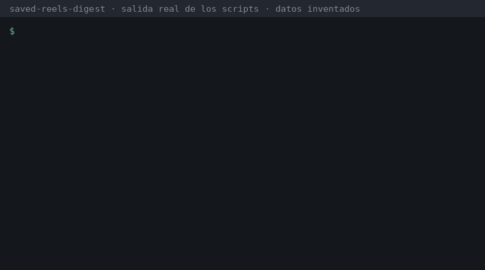

# Saved Reels Digest

[](https://github.com/ArmasCitoZ/saved-reels-digest/actions/workflows/ci.yml)
[](.claude-plugin/plugin.json)

[](LICENSE)

**Claude revisa por ti los reels que tienes guardados en Instagram.** Se queda solo con los del tema que te interesa (por defecto tech, IA y Claude), los transcribe, junta los que cuentan lo mismo y te deja un único documento ordenado por lo que más merece la pena.

> Guardas 200 reels de "este truco de Claude te cambia la vida" y nunca vuelves a verlos. Esto los convierte en una lista que sí vas a usar.



**Gratis de verdad:** no usa APIs de pago ni claves. La transcripción se hace en tu ordenador con [Whisper](https://github.com/SYSTRAN/faster-whisper) y el análisis lo hace Claude Code con tu suscripción normal. Tus datos se quedan en tu ordenador.

[English below](#english)

---

## Qué hace

1. **Recoge tus guardados.** Hay tres formas:
   - con la **exportación oficial** de Instagram, que no tiene ningún riesgo para tu cuenta;
   - con tu **sesión del navegador** (Chrome, Firefox, Edge...), que es al instante;
   - o haciendo que Claude **navegue tu página de guardados**, si tienes Claude in Chrome.

   ¿También guardas en TikTok? Tus **Favoritos** entran en el mismo resumen con la exportación oficial de TikTok (Ajustes y privacidad → Cuenta → Descargar tus datos → formato JSON).

   ¿Y **YouTube**? Tu lista *Ver más tarde* y tus listas de reproducción también entran, con [Google Takeout](https://takeout.google.com) (YouTube y YouTube Music) o leyendo una lista directamente.
2. **Lee los textos** de cada publicación y descarta lo que no es de tu tema (recetas, memes, viajes...).
3. **Transcribe en local** solo los reels que importan. El audio se borra justo después. Los **carruseles** y las fotos no tienen audio, así que Claude mira las imágenes y se queda con el texto; las imágenes también se borran.
4. **Junta los duplicados.** Si tres creadores explican el mismo truco, sale una sola entrada con lo mejor de cada uno y los tres enlaces. También marca contradicciones y cosas que suenan a hype o que pueden estar desactualizadas.
5. **Te entrega `digest.md`** con una sección **"Haz esto primero"** (los 5-10 consejos más útiles) y debajo todo organizado por categorías. Mira un [ejemplo con datos inventados](examples/digest.md).

¿Usas Obsidian? Pídele a Claude que exporte el resumen a tu bóveda: crea una nota por idea, con etiquetas por categoría, los reels de origen y enlaces entre ideas relacionadas, más un índice que marca con ✅ / 🚫 las ideas probadas o descartadas, con un `+N` al lado si guardaste N reels sobre ellas después de marcarlas (cada nota lleva también las propiedades `status`, `reels`, con cuántos reels respaldan la idea, y `last_saved`, la fecha del último, para filtrarlas y ordenarlas con Bases o Dataview; las ideas probadas o descartadas tienen además `new_since_mark`, cuántos reels guardaste sobre ellas después de marcarlas, así un filtro `new_since_mark > 0` te enseña las que tienen novedades). Si vuelves a exportar, se conserva lo que escribas bajo `## My notes`.

¿Prefieres Notion? Si tienes el conector de Notion activado en Claude, pídele *"pásalo a Notion"*: crea una página índice y una subpágina por idea (con categoría, estado, cuántos reels la respaldan, cuándo guardaste el último y enlaces a los reels). No necesitas API keys: usa el mismo conector que ya autorizaste.

Se puede volver a lanzar cuando quieras: solo procesa lo que hayas guardado desde la última vez y lo integra en el resumen que ya tienes.

## Instalación (1 minuto)

Necesitas [Claude Code](https://claude.com/claude-code) y Python 3.9 o superior. Abre Claude Code y escribe:

```
/plugin marketplace add ArmasCitoZ/saved-reels-digest
/plugin install saved-reels@saved-reels-digest
```

Reinicia Claude Code y escribe:

```
/saved-reels:digest
```

También puedes pedirlo con tus palabras: *"revisa mis reels guardados de Instagram y quédate con los de IA"*. Claude te guía en lo demás: crea su propio entorno de Python, te pregunta cómo quieres conectar Instagram y empieza.

¿Prefieres dejarlo todo preparado antes de abrir Claude Code? Un comando busca un Python que sirva, comprueba el equipo y crea el entorno de Python (se puede repetir sin miedo; con `--check-only` / `-CheckOnly` solo comprueba):

```sh
# macOS y Linux
curl -fsSL https://raw.githubusercontent.com/ArmasCitoZ/saved-reels-digest/main/install.sh | sh
```

```powershell
# Windows (PowerShell)
irm https://raw.githubusercontent.com/ArmasCitoZ/saved-reels-digest/main/install.ps1 | iex
```

Si las descargas empiezan a fallar al cabo de unos meses, casi siempre es un `yt-dlp` viejo (Instagram y TikTok cambian a menudo). Actualiza los paquetes del entorno con `sh install.sh --upgrade` (o `curl ... | sh -s -- --upgrade`) en macOS y Linux, o `-Upgrade` en Windows.

¿Estás en Windows? Tienes una [guía paso a paso](docs/windows.md), desde instalar Python hasta los errores más típicos.

Para elegir otro tema basta con decirlo: `/saved-reels:digest marketing y negocios`. Si ya ordenas tus guardados en colecciones de Instagram, puedes pedirle que use solo una: *"solo mi colección IA"*.

<details>
<summary>Instalación sin plugin (copiar la skill)</summary>

```bash
git clone https://github.com/ArmasCitoZ/saved-reels-digest
cp -r saved-reels-digest/skills/digest ~/.claude/skills/saved-reels-digest
```
Después, en Claude Code: `/saved-reels-digest`.
</details>

## Cómo conectar Instagram

| Opción | Riesgo para la cuenta | Velocidad | Cómo |
|---|---|---|---|
| **Exportación oficial** (recomendada) | Ninguno | Instagram tarda de minutos a horas en mandarte el zip | App → Configuración → Centro de cuentas → Tu información y permisos → Descargar tu información → *Parte de tu información* → **Guardado** → formato **JSON** |
| **Sesión del navegador** | Bajo (va despacio y se para sola si Instagram pone pegas) | Al instante | Tener la sesión de Instagram iniciada en Chrome, Firefox, Edge... |
| **Claude in Chrome** | Bajo | Al instante | Tener la extensión instalada |

Con cualquiera de las tres, el paso de transcribir descarga los reels uno a uno con [yt-dlp](https://github.com/yt-dlp/yt-dlp), dejando unos segundos entre cada uno.

> ⚠️ Las normas de Instagram no permiten el acceso automatizado. Las opciones 2 y 3 usan tu propia sesión igual que lo haría tu navegador, van despacio a propósito y se detienen al primer aviso de límite. Si no quieres arriesgar nada, usa la exportación oficial. Úsalo solo con tu propia cuenta.

## Costes y requisitos

- **0 €.** No hay API keys ni servicios de terceros.
- **Espacio en disco:** ~1 GB la primera vez (entorno de Python y el modelo Whisper, de unos 460 MB con `small`).
- **Modelo Whisper:** se elige solo según la RAM: `tiny` con menos de 4 GB, `base` con menos de 8 GB y `small` a partir de ahí (`medium` si hay GPU NVIDIA). Puedes forzar otro con `--model`.
- **Tiempo:** entre 10 y 30 segundos por reel en un portátil normal (sin GPU). Si tienes una GPU NVIDIA, se usa automáticamente.
- **Sistemas:** macOS, Linux y Windows.
- **Uso de Claude:** la clasificación y la fusión consumen mensajes de tu plan de Claude Code, igual que cualquier otra tarea.

## Dónde quedan tus datos

Todo se guarda en `~/saved-reels-digest/`. Puedes cambiar la carpeta con la variable `SRD_HOME`.

```
reels.json   base de datos local: enlace, autor, texto, transcripción y en qué idea acabó cada reel
reels.backup.json  copia de esa base de datos, como mucho de hace un día
digest.md    tu resumen
.venv/       entorno de Python aislado (no toca tu sistema)
.models/     modelo Whisper
.session/    sesión de Instagram (trátala como una contraseña)
.slides/     imágenes de carruseles, solo hasta que Claude las lee
```

Para borrarlo todo, elimina esa carpeta.

## Para desarrolladores

Los scripts están en `skills/digest/scripts/` y se pueden usar sin Claude:

```bash
python3 doctor.py                            # comprueba Python, disco, entorno y si yt-dlp está viejo
python3 setup_env.py                         # crea ~/saved-reels-digest/.venv (--upgrade: actualiza)
PY=~/saved-reels-digest/.venv/bin/python
$PY collect.py export ~/Downloads/instagram-xxxx.zip
$PY collect.py live --browser chrome
$PY collect.py tiktok ~/Downloads/TikTok_Data.zip   # favoritos de TikTok
$PY collect.py youtube ~/Downloads/takeout.zip       # listas de YouTube (Google Takeout)
$PY collect.py youtube --url WL --browser chrome   # o tu Ver más tarde, al momento
$PY fetch_meta.py
$PY db.py next                               # pendientes de clasificar
$PY db.py set relevant true CODE1 CODE2      # marcar relevantes
$PY db.py similar                            # posibles duplicados, también entre idiomas
$PY db.py dump                               # lo relevante, en páginas de ~60k caracteres (--offset N)
$PY db.py collections                        # colecciones de Instagram y listas de YouTube (para --collection "IA")
$PY transcribe.py                            # modelo según la RAM; omite vídeos de más de 30 min
$PY slides.py pending                        # carruseles y fotos por leer (fetch / save)
$PY db.py recent --days 7                    # lo guardado esta semana y en qué idea acabó
$PY db.py mark tried subagentes --note "útil"  # o discarded; el digest lo recuerda
$PY db.py marks --status tried                # solo las ideas probadas (o discarded)
$PY db.py marks                               # las ideas marcadas; +2 new = reels guardados sobre ellas después de marcarlas
$PY db.py marks --new                         # solo las marcadas que recibieron reels después de la marca
$PY db.py marks --new --collection "IA"       # lo mismo, contando solo los reels de esa colección o lista
$PY db.py marks --new --sort new              # primero las que tienen más reels nuevos (date: las marcadas hace más tiempo)
$PY db.py marks --new --sort new --limit 5    # solo las 5 primeras, y cuántas quedan fuera
$PY db.py marks --status discarded --older-than 180  # las descartadas hace más de medio año (¿otra oportunidad?)
$PY db.py ideas [--status todo] [--collection "IA"] [--sort recent]  # cada idea con sus reels, el último guardado y su marca
$PY db.py ideas --status todo --older-than 30  # ideas pendientes sin reels nuevos desde hace un mes (para repasarlas)
$PY db.py ideas --status todo --min-reels 3   # ideas pendientes con 3 reels o más: las que más se repiten, para probarlas primero
$PY db.py ideas --newer-than 7 --sort recent  # ideas con algún reel guardado esta semana (los temas que guardas ahora)
$PY db.py ideas --status todo --min-reels 3 --limit 5  # solo las 5 primeras, y cuántas quedan fuera
$PY db.py ideas subagentes                   # los reels de una idea: fecha, código, autor y enlace
$PY db.py ideas subagentes --since-mark      # solo los guardados después de marcarla (los +N new de marks)
$PY db.py check [--strict] [--fix]           # digest.md y la base coinciden (ideas sin reels, slugs rotos, marcas de ideas que ya no están); --strict sale con error si no; --fix aplica el rename que no tiene dudas
$PY db.py rename sub-agentes subagentes --digest  # renombrar o fusionar una idea: mueve sus reels y su marca y cambia {#slug} y (#slug) en digest.md
$PY db.py rename sub-agentes subagentes --digest --dry-run  # lo mismo, pero solo dice qué cambiaría
$PY db.py unavailable                        # guardados borrados o privados
$PY db.py status
$PY export_digest.py --vault ~/Obsidian/MiBoveda   # una nota por idea + INDEX.md
$PY export_digest.py --vault ~/Obsidian/MiBoveda --prune  # y borra las notas de ideas que ya no están
$PY export_digest.py --json                  # el resumen como JSON, con reels, last_saved y new_since_mark por idea (lo usa Claude para Notion)
```

¿Cambiaste el nombre de una idea o juntaste dos en una? `db.py rename VIEJO NUEVO` pasa todos sus reels (y lo que marcaste con `db.py mark`) al slug nuevo, así los reels que guardes después siguen yendo a la misma idea; con `--digest` cambia también el título y los enlaces en `digest.md`. Si ambas ideas estaban marcadas, se queda la marca de la nueva. Y si se te olvida, `db.py check` te dice el `rename` exacto que lo arregla; si solo hay un slug perdido y una sola idea sin reels, `db.py check --fix` lo aplica por ti (en cualquier otro caso solo avisa, porque elegir la idea correcta requiere criterio). Para ver qué ideas tienes ya (y no crear `sub-agentes` al lado de `subagentes`), `db.py ideas` las lista con cuántos reels tiene cada una, cuándo guardaste el último y si la marcaste; con `--status todo` solo las que te quedan por probar, con `--collection "IA"` solo las de esa colección o lista y con `--sort recent` (o `name`) primero las que tienen reels guardados hace menos (o por orden alfabético) y con `--min-reels 3` solo las que respaldan tres reels o más (las que más se repiten en lo que guardas: Claude las usa para proponerte qué probar primero); con `--newer-than 7` solo las que tienen algún reel guardado en los últimos 7 días (lo contrario de `--older-than`: los temas que estás guardando ahora) y con `--limit 5` solo las cinco primeras después de filtrar y ordenar, con una línea final que dice cuántas quedan fuera. Si marcaste una idea y después guardaste reels sobre ella, la lista lo dice con `+N new`, como `db.py marks`. ¿De dónde salió una idea? `db.py ideas subagentes` enseña sus reels, del más reciente al más antiguo, con el enlace a cada uno. ¿Ideas pendientes que se te olvidaron? `db.py ideas --status todo --older-than 30` lista las que no reciben reels nuevos desde hace más de 30 días; Claude te las recuerda al terminar el digest para que las pruebes o las descartes. Y al volver a marcar una idea (`db.py mark discarded subagentes` después de `mark tried ... --note "útil"`) la nota se conserva; `--note ""` la borra. `db.py marks` pone `+2 new` junto a las ideas sobre las que guardaste reels después de marcarlas: si descartaste una idea y sigues guardando reels sobre ella, te lo dice al final (quizá merece otra oportunidad), y si ya la probaste, puede que esos reels traigan trucos nuevos. Con `db.py marks --new` salen solo esas ideas (combínalo con `--status tried` o `--status discarded`; con `--sort new` primero las que tienen más reels nuevos y con `--sort date` primero las que marcaste hace más tiempo), y `db.py ideas subagentes --since-mark` enseña justo esos reels nuevos, sin mezclarlos con los de antes de la marca; Claude hace las dos cosas en el repaso semanal. Si trabajas con una sola colección o lista, `db.py marks --collection "IA"` enseña solo las ideas marcadas con reels de ella y el `+N new` cuenta solo esos reels, así el repaso de "IA" no se mezcla con lo que guardas en "Cocina". Con `--limit 5` salen solo las cinco primeras (después de filtrar y ordenar) y una línea final dice cuántas quedan fuera, y con `--older-than 180` solo las que marcaste hace más de 180 días: una idea descartada hace medio año quizá merece otra oportunidad (Claude te lo pregunta de vez en cuando con `--status discarded --older-than 180`). Si borras del digest una idea que habías marcado, `db.py check` te dice cómo arreglarlo: el `db.py rename` para que la marca siga a la idea si solo le cambiaste el nombre, o `db.py mark todo SLUG` para olvidar la marca si la quitaste a propósito. Cuando ya los has leído, vuelve a marcar la idea (`db.py mark tried subagentes`): el `+N` vuelve a cero y la nota se conserva, así el repaso de la semana siguiente solo te enseña lo nuevo de verdad (`marks --new` te da el comando exacto al final, y Claude lo hace por ti tras el repaso).

Antes de fusionar, `db.py rename ... --dry-run` dice cuántos reels se moverían, qué pasa con las marcas y cuántos títulos y enlaces cambiarían en `digest.md`, sin tocar nada. Y para que una idea no acabe partida en dos: `db.py set entry subagente ...` avisa si ya existe `subagentes` (se guarda igual, pero te da el `rename` para juntarlas), y `db.py check` lista las ideas del digest con slugs casi iguales en "Maybe the same idea" (es solo una pista: `--strict` no falla por eso).

¿Reclasificaste como no relevante un reel que ya estaba en una idea? `db.py set relevant false` lo guarda igual, pero avisa de que sigue respaldando esa idea y te da el `db.py set entry none CODE` para sacarlo. Si se te pasa, `db.py check` lo señala con los dos arreglos posibles: volver a marcarlo relevante o sacarlo de la idea.

Para correr los tests y el linter igual que en CI:

```bash
python -m pip install pytest ruff
python -m pytest -q
ruff check .
```

¿Tienes miles de reels? `db.py similar` compara cada uno con todos los demás y con 2.000+ tarda. Hay una versión en Rust opcional que da exactamente los mismos grupos mucho más rápido (con 2.000 reels, de un minuto a 2,5 segundos: ver [benchmarks](docs/benchmarks.md)): a partir de la próxima versión puedes descargar el binario ya compilado para Linux, macOS o Windows desde la página de [releases](https://github.com/ArmasCitoZ/saved-reels-digest/releases), renombrarlo a `reels-similar` (`reels-similar.exe` en Windows) y ponerlo en tu PATH (o su ruta en la variable `SRD_REELS_SIMILAR`); o compilarlo tú con `cd rust && cargo build --release` (queda en `rust/target/release/`). `db.py similar` la usa sola si la encuentra; con `--engine python` fuerzas la de siempre. Más detalles en [rust/README.md](rust/README.md).

¿Tu `digest.md` ya es largo? En `viewer/` hay un visor local en TypeScript: `cd viewer && npm install && npm run build` y abre `viewer/dist/index.html` en el navegador. Cargas `digest.md` (y, si quieres, `reels.json` para ver de qué reels sale cada idea y lo que marcaste con `db.py mark`) y puedes buscar sin importar tildes ni mayúsculas, filtrar por categoría o estado, ver con `+N nuevos` las ideas marcadas que recibieron reels después de la marca (y quedarte solo con esas con "Con novedades") y marcar ideas como probadas o descartadas: el visor te da los comandos `db.py mark` para guardarlas. No hay servidor y no se sube nada. Detalles en [viewer/README.md](viewer/README.md).

Se aceptan PRs: lee antes [CONTRIBUTING.md](CONTRIBUTING.md) (principios del proyecto y cómo probar). Ideas pendientes en el [ROADMAP](ROADMAP.md).

---

## English

**Claude goes through your saved Instagram reels for you.** It keeps the ones about your topic (tech/AI/Claude by default), transcribes them locally with Whisper, merges reels that say the same thing, and writes one ranked `digest.md` with a "Do these first" list ([sample, in Spanish](examples/digest.md)). It can also export that digest to an Obsidian vault (one note per idea) or, with Claude's Notion connector enabled, to Notion pages.

It's free: there are no paid APIs or keys. Transcription runs on your machine and the analysis runs in your normal Claude Code plan.

```
/plugin marketplace add ArmasCitoZ/saved-reels-digest
/plugin install saved-reels@saved-reels-digest
/saved-reels:digest
```

To check the computer and set up the Python environment before opening Claude Code: `curl -fsSL https://raw.githubusercontent.com/ArmasCitoZ/saved-reels-digest/main/install.sh | sh` on macOS and Linux, or `irm https://raw.githubusercontent.com/ArmasCitoZ/saved-reels-digest/main/install.ps1 | iex` in PowerShell on Windows ([guide, in Spanish](docs/windows.md)).

You can connect Instagram with the official data export (no risk), your logged-in browser session, or Claude in Chrome. Instagram's terms forbid automated access, so the live options go slowly and stop at the first rate-limit sign. Only use this with your own account. TikTok favorites can be added from TikTok's official data export (`collect.py tiktok`). YouTube Watch Later and playlists come from Google Takeout or straight from a playlist link (`collect.py youtube`).

## License

MIT
